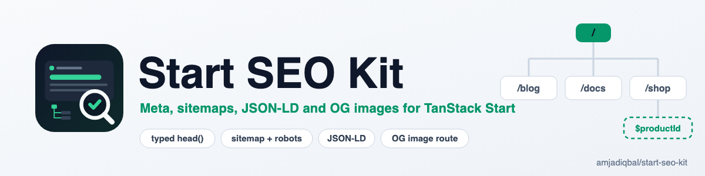

  <picture>
    <source media="(prefers-color-scheme: dark)" srcset="art/banner-dark.png">
    
  </picture>

# Start SEO Kit: SEO for TanStack Start

Typed meta tags for `head()`, dynamic sitemaps and robots.txt from server routes, JSON-LD helpers and an optional Open Graph image route for TanStack Start apps.

> **Status:** in development. Nothing is published to npm yet.

## Need this built into your app, or something custom?

[Get in touch](https://amjad.com.pk/contact?utm_source=github&utm_medium=readme&utm_campaign=start-seo-kit).

## License

MIT. See [LICENSE.md](LICENSE.md).
